# 🚀 ROADMAP: Defuse — Dispute-Risk Support Automation Agent
### polyTech Code Fest × SKELAR | Дедлайн: 17:00

> **One-liner:** AI-оператор підтримки для subscription-продуктів (Calmly), який вирішує billing-проблему за 30 секунд — **до того, як клієнт піде в банк**.
> **Архітектурний принцип:** LLM розуміє контекст, емоції, сарказм та пише текст, але **гроші та підписки змінює виключно детермінований код (Policy Engine)**.
> **Цільова юніт-економіка:** Захист від перевищення порогу Visa VAMP (1.5% з квітня 2026), економія $8/диспут штрафу, pre-dispute $15-29 fee, збереження мерчант-акаунта.

---

## 🎯 Критерії оцінювання Skelar & Як ми беремо максимум

| Критерій | Наша реалізація у Defuse |
|---|---|
| **Operational Impact** | Прямий розрахунок зекономлених грошей ($ at risk vs $ saved), VAMP-прогноз (1.8% -> 1.2%), відвернення чарджбеків. |
| **Innovation** | Dispute-Risk Engine, розпізнавання сарказму / прихованої агресії ("Love being charged 🙂"), cost-of-resolution (рефанд дешевше за диспут). |
| **Use of AI** | AI в центрі тріажу, класифікації намірів (structured JSON output), контекстного пояснення та мультиязичних відповідей. |
| **Reasoning & Context** | User 360: зіставлення тексту звернення з днями після закінчення тріалу, кількістю сесій у застосунку, статусом підписки. |
| **Technical Execution** | Захист від Prompt Injection до виклику LLM, `defuse-data/evaluate.py` з тестами 38 eval-тікетів (0 unsafe refunds), pytest, відповідність структурі `docs/features/`. |
| **Presentation & Demo** | Живе 3-хвилинне демо (сарказм -> авто-резолюція, ambiguous -> 1-click approve, injection -> блок, дашборд), презентація ≤10 слайдів. |

---

## 🏗 Архітектура Defuse

```
┌────────────────────────────────────────────────────────────────────────┐
│               FRONTEND: React + Vite + TS + Tailwind + Lucide          │
│   ├── Ticket Queue (сортування за пріоритетом: Risk × Amount × SLA)    │
│   ├── Ticket Card (Customer 360, Risk Badges, Policy Decision)         │
│   ├── Actions Panel (One-Click Approve, Edit, Reject, Manual Override) │
│   ├── Live Simulation ("New Ticket" input для live-демо на пітчі)      │
│   └── Analytics Dashboard (VAMP ratio, $ saved, Root Causes, Funnel)   │
└──────────────────────────────────┬─────────────────────────────────────┘
                                   │ REST API (JSON)
┌──────────────────────────────────▼─────────────────────────────────────┐
│                       BACKEND: FastAPI + Python                        │
│   ├── Guard: prompt injection regex & safety layer (до LLM)            │
│   ├── LLM Classifier: Structured Intent, Sarcasm, Aggression, Risk     │
│   ├── Context Builder: зв'язування з billing, usage, payments          │
│   ├── Policy Engine: детерміновані правила бізнесу (defuse-data)       │
│   ├── Action Executor: mock billing (refund, cancel, pause, extend)    │
│   ├── Reply Writer: персоналізована відповідь мовою звернення          │
│   ├── Audit Trail: незмінний лог усіх дій (idempotency token)          │
│   └── Store & Analytics: in-memory з підтримкою скидання (reset)        │
└────────────────────────────────────────────────────────────────────────┘
```

---

## ⏱ Графік реалізації (Дедлайн: 17:00)

```mermaid
gantt
    title Defuse Hackathon Roadmap (31.10.2026)
    dateFormat  HH:mm
    axisFormat %H:%M

    section Backend & Core
    Backend Scaffold & Data Store     :11:40, 30m
    Guard, Classifier & Policy Engine :12:10, 40m
    Executor & API Endpoints          :12:50, 40m

    section Frontend
    Vite + React UI Scaffolding       :12:30, 45m
    Queue, Ticket View & Copilot      :13:15, 60m
    Dashboard & Live Demo Input       :14:15, 45m

    section Testing & Docs
    Eval & Unit Tests (0 unsafe)      :15:00, 30m
    SKELAR-style Feature Docs         :15:30, 30m

    section Delivery
    Slide Deck & Demo Script          :16:00, 30m
    Video Recording & Zip Packaging   :16:30, 30m
```



---

## 📋 Детальні етапи та чеклист

### Етап 1: Backend Foundation & Integration (11:40 – 13:30)
- [ ] Скопіювати готові датасети `defuse-data/data/*.json` у `backend/data/`
- [ ] Створити `backend/app/store.py` (in-memory база, швидкий reset)
- [ ] Портувати `reference_policy.py` у `backend/app/policy/reference_policy.py`
- [ ] Реалізувати `backend/app/guard/injection.py` (жорсткий бар'єр проти prompt injection)
- [ ] Реалізувати `backend/app/llm/classifier.py` (з fallback на mock/gold для швидкого тестування без інтернету / затримок)
- [ ] Реалізувати `backend/app/llm/reply_writer.py`
- [ ] Реалізувати `backend/app/billing/mock_billing.py` та `executor.py` з idempotency
- [ ] Реалізувати роутери: `/api/tickets`, `/api/tickets/{id}/analyze`, `/api/tickets/{id}/execute`, `/api/tickets/new`, `/api/analytics`, `/api/demo/reset`

### Етап 2: Frontend — Modern Support Copilot (12:30 – 15:00)
- [ ] Ініціалізувати Vite + React + Tailwind + Lucide-react
- [ ] **Компонент Queue:** черга тікетів з бейджами терміновості (CRITICAL, HIGH, NORMAL), іконками ризику сарказму / чарджбеку
- [ ] **Компонент TicketView:**
  - Звернення клієнта з виділенням підозрілих фраз (evidence spans)
  - User 360 (План, LTV, активність, останні транзакції, дні від кінця тріалу)
  - Рішення Policy (Auto / Suggest / Escalate)
  - Список запропонованих дій (`refund`, `cancel_subscription`, `extend_access`)
  - Кнопки: `[Approve & Execute]`, `[Reject]`, `[Manual Action]`
  - Чернетка відповіді AI з можливістю швидкого редагування
- [ ] **Компонент Live Input:** поле для введення довільного тексту під час пітчу (live testing)
- [ ] **Компонент Analytics Dashboard:**
  - Лічильник збережених грошей ($ saved) та відвернутих чарджбеків
  - Динаміка VAMP ratio (до Defuse vs після Defuse)
  - Кластери root-cause проблем (наприклад: "38% — списання після тріалу")

### Етап 3: Тести, Eval & Документація для журі (15:00 – 16:00)
- [ ] Запустити `evaluate.py` через наш пайплайн: досягти 0 Unsafe auto-refunds і 100% захисту від injection
- [ ] Написати `pytest` на policy engine та executor
- [ ] Створити 10 файлів за стандартом Skelar у `docs/features/`:
  - `triage/` (класифікація, ризик, сарказм)
  - `action-engine/` (policy, execution, audit)
  - `agent-copilot/` (картка оператора, approve-потік)
  - `analytics/` (VAMP, unit economics, root-cause)

### Етап 4: Фіналізація та Здача (16:00 – 17:00)
- [ ] Презентація (до 10 слайдів, структурована за болями Skelar):
  1. Хук: цитата саркастичного клієнта + ризик chargeback/VAMP
  2. Проблема: чат-боти говорять, а не вирішують. Вартість VAMP 1.5%
  3. Рішення: Defuse — Dispute-Risk Support Automation
  4. Як це працює: Intent & Sarcasm -> User 360 -> Deterministic Policy -> Action
  5. Безпека: чому LLM не рухає гроші самостійно + захист від Prompt Injection
  6. Скріншоти та посилання на відеодемо
  7. Результати Eval: 0 небезпечних рефандів, 100% виявлення ін'єкцій
  8. Юніт-економіка для бізнесу: збереження $40k-60k/міс та захист мерчант-акаунта
  9. Команда та масштабування
- [ ] Запис відеодемо (2-3 хв) із проходженням 4 ключових кейсів демо-скрипта
- [ ] Збирання репозиторію в чистий ZIP-архів
- [ ] Пуш в GitHub: https://github.com/MrmaderatorYT/skelar-resolvai
