# 🚀 ROADMAP: Defuse — AI Support Operations Agent (Java Spring Boot 3 + React)
### polyTech Code Fest × SKELAR | Дедлайн: 17:00

> **One-liner:** Enterprise AI-оператор підтримки для subscription-продуктів (Calmly) на **Java Spring Boot 3**, який вирішує billing-проблему за 30 секунд — **до того, як клієнт піде в банк**.
> **Архітектурний принцип:** LLM класифікує намір, виявляє сарказм та пише ввічливу відповідь, але **рух коштів і зміну підписок здійснює суворо типізований детермінований Java Policy Engine**.
> **Цільова юніт-економіка:** Захист від перевищення порогу Visa VAMP (1.5% з квітня 2026), економія $8/диспут штрафу, pre-dispute $15-29 fee, збереження мерчант-акаунта.

---

## 🏗 Архітектура рішення

```
┌────────────────────────────────────────────────────────────────────────┐
│               FRONTEND: React + Vite + TS + Tailwind + Lucide          │
│   ├── Ticket Queue (Priority = RiskScore × Amount × SLA)               │
│   ├── Ticket Card (Customer 360, Risk Badges, Policy Decision)         │
│   ├── Actions Panel (One-Click Approve, Reject, Manual Override)       │
│   ├── Live Simulator ("New Ticket" input для live-демо на пітчі)      │
│   └── Analytics Dashboard (VAMP ratio, $ saved, Root Causes, Funnel)   │
└──────────────────────────────────┬─────────────────────────────────────┘
                                   │ REST API (JSON)
┌──────────────────────────────────▼─────────────────────────────────────┐
│                    BACKEND: Java 17+ / Spring Boot 3                   │
│   ├── Security Guard: InjectionGuardService (regex-захист до LLM)      │
│   ├── AI Integration: LlmClassifierService & ReplyWriterService        │
│   ├── Context Service: Customer 360 збирання з InMemoryStore           │
│   ├── Business Policy: ReferencePolicyService (детермінована логіка)   │
│   ├── Action Executor: ActionExecutorService з перевіркою ідемпотентності│
│   ├── Audit Trail: AuditService (незмінний лог операцій)               │
│   └── In-Memory Data Store: DataLoader (швидкий reset і mock billing)  │
└────────────────────────────────────────────────────────────────────────┘
```

---

## ⏱ План розробки (Java Spring Boot + React)

```mermaid
gantt
    title Defuse Spring Boot Roadmap (31.10.2026)
    dateFormat  HH:mm
    axisFormat %H:%M

    section Spring Boot Core
    Scaffold Gradle Spring Boot 3     :11:45, 25m
    In-Memory Store & Data Loaders    :12:10, 25m
    Policy Service & Injection Guard  :12:35, 35m
    LLM Client & Action Executor API  :13:10, 35m

    section Frontend
    Vite + React UI Scaffolding       :12:45, 30m
    Support Copilot & Actions UI      :13:15, 60m
    Live Simulator & Analytics Tab    :14:15, 45m

    section Testing & Docs
    JUnit 5 Policy Tests (38 cases)   :15:00, 30m
    SKELAR-style Feature Docs         :15:30, 30m

    section Final Delivery
    Slide Deck & Demo Script          :16:00, 30m
    Video Recording & Zip Packaging   :16:30, 30m
```



---

## 📋 Чеклист виконання

### 🔹 Етап 1: Spring Boot Бекенд (11:45 – 13:45)
- [ ] Створити проєкт `backend` на Gradle (Spring Boot 3.3+, Java 17+, Spring Web, Jackson, Lombok/Records).
- [ ] Завантажити JSON-файли з `defuse-data/data/` у ресурси бекенду (`customers.json`, `payments.json`, `subscriptions.json`, `usage.json`, `tickets_eval.json`).
- [ ] Портувати логіку `reference_policy.py` на Java: `ReferencePolicyService` (детерміновані правила повернення коштів, скасування, паузи).
- [ ] Реалізувати `InjectionGuardService` (захист від jailbreak до виклику LLM).
- [ ] Реалізувати `ActionExecutorService` з фіксацією ідемпотентності дій у пам'яті.
- [ ] Створити контролери:
  - `GET /api/tickets` — список із розрахунком пріоритетів.
  - `POST /api/tickets/{id}/analyze` — аналіз тікета (Guard -> LLM -> Policy -> Draft).
  - `POST /api/tickets/{id}/execute` — виконання схваленої дії.
  - `POST /api/tickets/simulate` — додавання живого тікета під час виступу.
  - `GET /api/analytics/dashboard` — розрахунок врятованих коштів та VAMP ratio.
  - `POST /api/demo/reset` — скидання бази до початкового стану.

### 🔹 Етап 2: Фронтенд на React + Vite (12:45 – 15:00)
- [ ] Налаштувати Vite + React + Tailwind + Lucide Icons.
- [ ] Реалізувати кабінет саппорта:
  - Ліва колонка: пріоритезована черга з ризиками сарказму/чарджбеку.
  - Центр: Customer 360 (платежі, активність) + виділення сарказму у тексті.
  - Блок рішень AI: бейдж режиму (`AUTO`, `SUGGEST`, `ESCALATE`) + кнопка `Approve Action`.
  - Чернетка відповіді з можливістю швидкого редагування.
- [ ] Реалізувати Live-симулятор для пітчу.
- [ ] Реалізувати вкладку аналітики (VAMP прогноз, врятовані кошти, Top Root Causes).

### 🔹 Етап 3: Тестування та Документація (15:00 – 16:00)
- [ ] Написати JUnit 5 тести на `ReferencePolicyService` (перевірка 38 кейсів: 0 небезпечних рефандів).
- [ ] Оформити документацію `docs/features/` за структурою SKELAR.

### 🔹 Етап 4: Презентація та здача (16:00 – 17:00)
- [ ] Презентація до 10 слайдів з фінансовими графіками (VAMP, врятовані $).
- [ ] Відеодемонстрація сценарію (3 хвилини).
- [ ] ZIP архів + пуш у GitHub.
